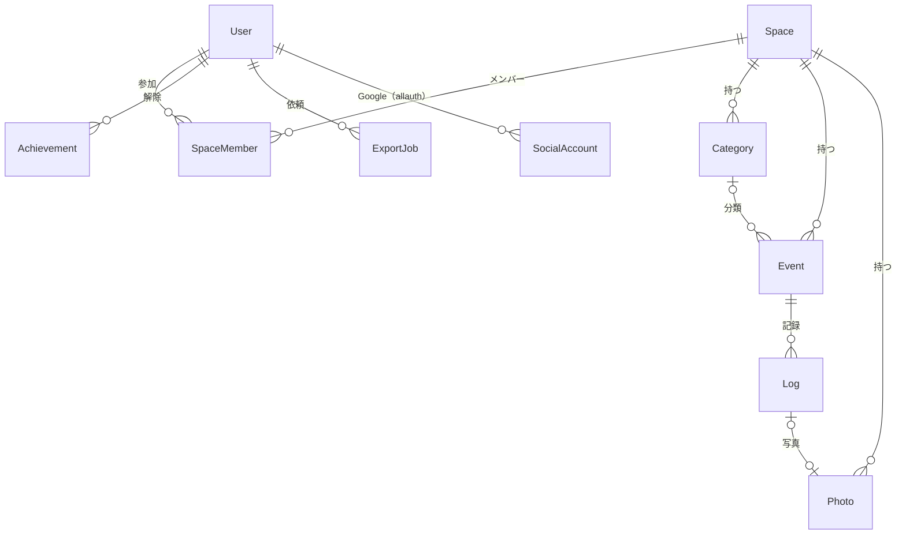

# データモデル（v1）

SPEC.md と決定記録 001〜031 をもとにしたデータモデル。DB は PostgreSQL、ORM は Django。

## 方針

- **主キーは UUID（v7）**。時刻順に並ぶので、インデックスの局所性も良い。URL に出しても推測されにくい（レビュー E12）。記録の ID は端末で作る（決定 028）
- **持ち主は「スペース」**。イベント・カテゴリ・記録・写真はスペースに属する。v1 では、ユーザーごとに個人用のスペースを1つ自動で作る（決定 004）。権限チェックは「そのスペースのメンバーか」で行い、サービス層で一元化する（決定 027、レビュー S4）
- **記録の日付は `local_date`**。すべての記録が持ち、記録した後は変えない。時刻ありの記録は `occurred_at` と `timezone` も持つ（決定 026）
- **ホームの表示に使う値は Event にキャッシュする**（最終記録日、記録回数、連続記録）。記録の追加・編集・削除のときにだけ更新する（レビュー E5）
- **並び順は文字列のソートキー**（分数インデックス）。動かした1件だけを更新する（レビュー E6）
- **削除は物理削除**。アーカイブは Event のフラグで表す

## ER 図

## テーブル

### User（accounts）
Django のカスタムユーザー。パスワードは使わない（Google ログインのみ、決定 016）。

| 列 | 型 | 説明 |
|---|---|---|
| id | uuid PK | |
| email | varchar(254) | Google から受け取る。表示と連絡用。**識別には使わない** |
| display_name | varchar(100) | Google の表示名 |
| timezone | varchar(64) | IANA 名。初期値は初回ログイン時の端末の設定（決定 023） |
| timezone_kept_for | varchar(64) null | 「このまま」を選んだ端末のタイムゾーン。同じものについては再び聞かない |
| onboarded_at | timestamptz null | テンプレート選択を終えた日時 |
| terms_version / privacy_version | varchar(20) | 同意した利用規約・ポリシーの版 |
| terms_accepted_at | timestamptz | |
| is_active | bool | 管理画面で利用を止めると false（ログインできなくなる、決定 045）。写真を入れたら、退会の手続き中にも使う（決定 040） |
| deletion_requested_at | timestamptz null | 退会を受け付けた日時。削除ジョブが完了したら行ごと消える |
| created_at / last_login | timestamptz | |

- Google の識別子（`sub`）は、django-allauth の `SocialAccount.uid` に入る。ユーザーの照合は `sub` で行い、`email_verified` が true の場合だけログインを受け付ける（レビュー S3）

### Space / SpaceMember（spaces）

| Space の列 | 型 | 説明 |
|---|---|---|
| id | uuid PK | |
| kind | varchar(16) | `personal`（v1 はこれだけ） |
| name | varchar(40) | 共有に対応するまでは使わない |
| created_at | timestamptz | |

| SpaceMember の列 | 型 | 説明 |
|---|---|---|
| id | uuid PK | |
| space | FK → Space（CASCADE） | |
| user | FK → User（CASCADE） | |
| role | varchar(16) | `owner`（v1 はこれだけ） |
| created_at | timestamptz | |

- 制約：`UNIQUE(space, user)`
- 写真の使用量の上限（1GB）は、スペースの持ち主のユーザー単位で数える（5章）

### Category（events）

| 列 | 型 | 説明 |
|---|---|---|
| id | uuid PK | |
| space | FK → Space（CASCADE） | |
| name | varchar(20) | |
| emoji | varchar(16) | 任意の絵文字1つ。なければ空文字（決定 036） |
| sort_key | varchar(64) | タブの並び順（分数インデックス） |
| created_at / updated_at | timestamptz | |

- 制約：`UNIQUE(space, name)`
- インデックス：`(space, sort_key)`

### Event（events）

| 列 | 型 | 説明 |
|---|---|---|
| id | uuid PK | |
| space | FK → Space（CASCADE） | |
| category | FK → Category（SET NULL）null | カテゴリを消すと「なし」になる（013） |
| name | varchar(40) | |
| emoji | varchar(16) | 絵文字1つ（書記素1つ分を検証する） |
| color | varchar(16) | パレットの名前（tomato, tangerine, sun, leaf, teal, sky, grape, pink） |
| streak_unit | varchar(8) | `none` / `day` / `week` / `month`。初期値は `day`（決定 015） |
| sort_key | varchar(64) | ホームの並び順（分数インデックス、決定 008・013） |
| is_archived | bool | |
| archived_at | timestamptz null | |
| created_by | FK → User（SET NULL）null | 共有に備えて持っておく |
| created_at / updated_at | timestamptz | |
| **キャッシュ** | | 記録を追加・編集・削除したときに、同じトランザクションの中で更新する |
| last_local_date | date null | 最新の記録の日付。経過日数 ＝ 今日（ユーザーのタイムゾーン）− この日付（0未満なら0） |
| last_occurred_at | timestamptz null | 最新の記録の日付（last_local_date）にある、時刻ありの記録のうち一番新しい時刻。今日の記録を「さっき」「N時間」と表示するために使う（決定 034） |
| log_count | int | 記録回数 |
| streak_count | int | 連続回数（連続の最後の期間までの値） |
| streak_period | int null | 連続の最後の期間の番号（下記） |

- 制約：`CHECK (streak_unit IN (...))`、`CHECK (color IN (...))`
- インデックス：`(space, is_archived, sort_key)`（ホームの表示）、`(space, category, is_archived, sort_key)`（タブの表示）

**連続記録のキャッシュの使い方**
- 期間の番号：`day` は日付の通し番号、`week` は月曜始まりの週の通し番号、`month` は `年×12＋月`
- 表示のときに「今の期間」の番号と比べるだけで状態が決まる。日付が変わっても、キャッシュを更新し直す必要はない
  - `streak_period ＝ 今の期間`：連続中（🔥を通常表示）
  - `streak_period ＝ 今の期間 − 1`：今の期間はまだ（🔥をグレーで表示）
  - それ以外：連続は途切れている（バッジを出さない）
- 記録を追加・編集・削除したときは、そのイベントの記録がある期間を新しい順にたどって、`streak_count` と `streak_period` を計算し直す（途切れたところで止まるので、件数が多くても軽い）

### Log（events）

| 列 | 型 | 説明 |
|---|---|---|
| id | uuid PK | **端末で作る**。同じ ID が再送されても1件しか作らない（決定 028）。他のスペースの ID と重なったら拒否する |
| space | FK → Space（CASCADE） | 権限チェックと集計のために Event から複製して持つ |
| event | FK → Event（CASCADE） | |
| local_date | date | 記録の日付（決定 026）。未来の日付は不可（サービス層で検証） |
| occurred_at | timestamptz null | 時刻ありの記録の瞬間（UTC） |
| timezone | varchar(64) null | 時刻ありの記録をしたときのタイムゾーン |
| memo | text | 1,000文字まで。空文字も可 |
| source | varchar(8) | `app` / `ai` / `url`（AI から記録した印、3.9） |
| created_by | FK → User（SET NULL）null | 共有に備えて持っておく |
| created_at / updated_at | timestamptz | |

- 制約：`CHECK ((occurred_at IS NULL) = (timezone IS NULL))`、`CHECK (char_length(memo) <= 1000)`、`CHECK (source IN (...))`
- インデックス
  - `(event, local_date DESC, occurred_at DESC)`：履歴の表示、連続記録の計算
  - `(space, local_date)`：実績の判定（1日に5種類など）、書き出し
- 並び順：`local_date DESC, occurred_at DESC NULLS LAST, created_at DESC`（同じ日の中では、時刻ありの記録を先に、時刻なしの記録を後に並べる）

### Photo（media）

| 列 | 型 | 説明 |
|---|---|---|
| id | uuid PK | |
| space | FK → Space（CASCADE） | |
| log | OneToOne → Log（CASCADE） | 1記録につき1枚 |
| object_key | varchar(200) | R2 のキー（本体、長辺1600px WebP）。例：`p/{space_id}/{photo_id}.webp` |
| thumb_key | varchar(200) | サムネイル（長辺400px） |
| bytes | int | 本体とサムネイルの合計。使用量の計算に使う |
| width / height | int | |
| created_at | timestamptz | |

- 使用量：持ち主のスペースの `SUM(bytes)`。上限は1GB（決定 024）
- アップロード回数の上限（1日100枚）は、`created_at` で数える

### StorageDeletion（media）
R2 上のファイルを確実に削除するための待ち行列。記録・イベントの削除と退会の処理で、DB の行を消すときに同じトランザクションの中でここに積み、ワーカーが R2 から削除する。

| 列 | 型 | 説明 |
|---|---|---|
| id | bigint PK | |
| object_key | varchar(200) | |
| attempts | int | 失敗したら再試行する |
| last_error | text | |
| created_at | timestamptz | |

### Achievement（achievements）
実績の定義（16種類）はコードに持ち、DB には解除の記録だけを残す。

| 列 | 型 | 説明 |
|---|---|---|
| id | uuid PK | |
| user | FK → User（CASCADE） | 実績は人に付く（スペースではなく） |
| code | varchar(32) | `first`、`t100`、`s1` など |
| unlocked_at | timestamptz | |

- 制約：`UNIQUE(user, code)`
- 記録を削除しても、解除の記録は消さない（決定 020）
- 「シェアデビュー」は、シェアが行われたときに端末から通知を受けて解除する（シェア自体は端末で完結するため）
- `User.achievements_synced`：実績の判定を始めたか。機能が入る前からの人は False で入れ、最初の判定でまとめて静かに解除する（決定 063）

### ExportJob（exports）

| 列 | 型 | 説明 |
|---|---|---|
| id | uuid PK | |
| user | FK → User（CASCADE） | |
| status | varchar(12) | `queued` / `running` / `done` / `failed` / `expired` |
| object_key | varchar(200) null | ZIP ファイルの R2 上のキー（非公開） |
| bytes | bigint null | |
| requested_at / finished_at | timestamptz | |
| expires_at | timestamptz null | 完了から7日後。過ぎたらファイルを削除し、`expired` にする |
| error | text | |

- 1日1回まで（`requested_at` で判定する）
- ダウンロードにはログインが必要。本人の `done` のジョブだけを、その場で作った短い有効期限の URL で返す（レビュー S6）

### その他（ライブラリが作るテーブル）
- django-allauth：`SocialAccount`（Google の `sub`）、`SocialToken`（保存しない設定にする）
- Django：セッション
- Django Tasks のバックエンド：ジョブの待ち行列
- v1.x：django-oauth-toolkit（MCP 用の OAuth のアプリ・トークン）

## 主な処理とデータの動き

| 処理 | データの動き |
|---|---|
| 初回ログイン | User を作る → 個人用の Space と SpaceMember（owner）を作る → テンプレート選択へ |
| タップで記録 | 端末で作った ID で Log を作る（同じ ID がすでにあれば、それを返す）→ Event のキャッシュを更新 → 実績を判定 → 結果（経過日数、連続記録、新しく解除した実績）を返す |
| 取り消し | Log を削除 → Event のキャッシュを計算し直す（実績はそのまま） |
| 記録の編集 | `local_date`・`occurred_at`・`timezone` を、編集したときのタイムゾーンで決め直す → キャッシュを計算し直す |
| 写真の追加 | サーバーで検証して作り直す（決定 029）→ R2 に保存 → Photo を作る |
| イベントの削除 | Log と Photo は CASCADE で消える。写真のファイルは StorageDeletion に積む |
| 書き出し | ExportJob を作る → ワーカーが ZIP を作って R2 に置く → `done` |
| 退会 | User を `is_active=false` にし、セッションとトークンを無効にする → ワーカーが写真を StorageDeletion に積み、Space（CASCADE で全データ）・Achievement・ExportJob・SocialAccount・User を削除する |

## 統計の計算（イベント詳細）

すべて `local_date` を使う SQL で求める。

| 統計 | 計算 |
|---|---|
| 記録回数 | `log_count`（キャッシュ） |
| 今年の回数 | `COUNT(*) WHERE local_date >= 今年の1月1日` |
| 平均間隔 | 記録がある日の数を N として、`(MAX(local_date) − MIN(local_date)) ÷ (N − 1)`。N が2未満なら出さない |
| よくやる時期 | `GROUP BY EXTRACT(YEAR FROM local_date), EXTRACT(MONTH FROM local_date)` |
| カレンダー | 表示している月の `DISTINCT local_date` |

## 決めていないこと

- 分数インデックスのライブラリ（Python 用の実装を選ぶ。または自前で実装する）
- UUID v7 の生成方法（Python 3.14 の標準機能、または `uuid-utils` などのライブラリ）
- Django Tasks のバックエンドの選定（レビュー E7）
